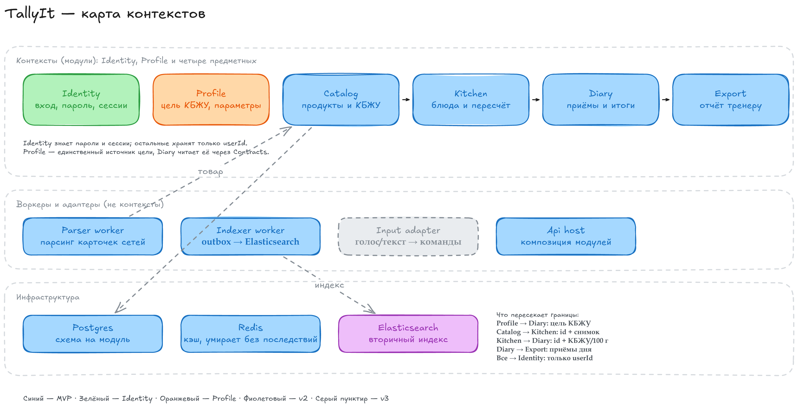
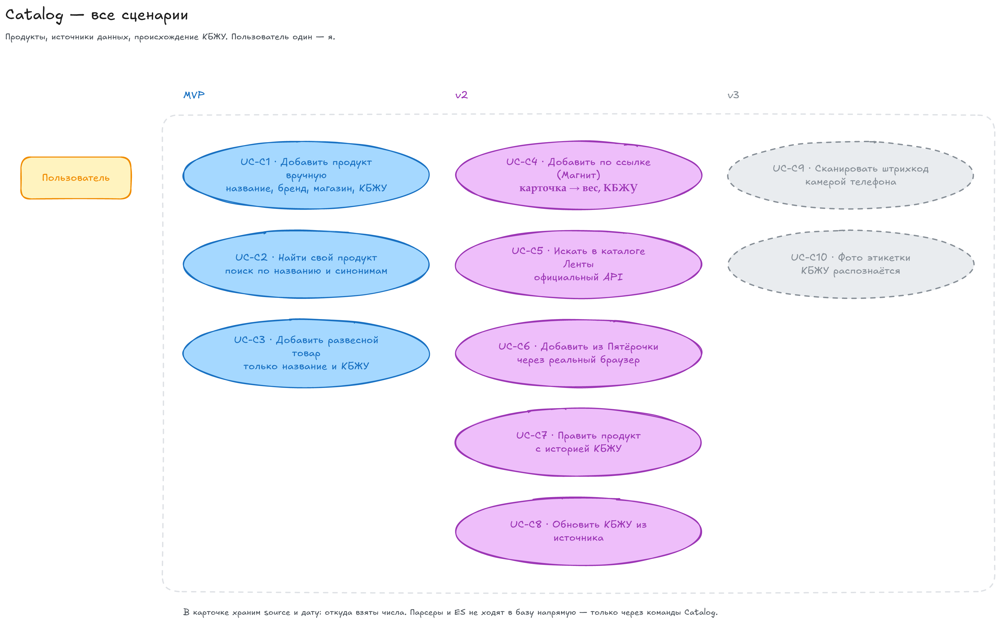
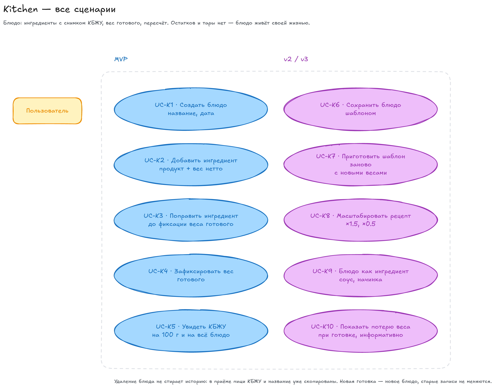
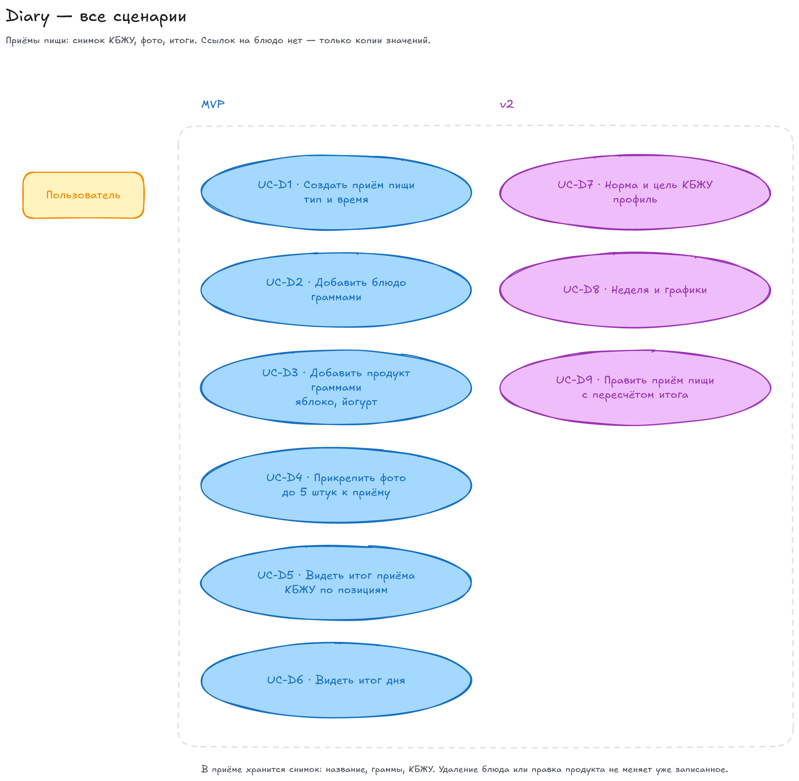
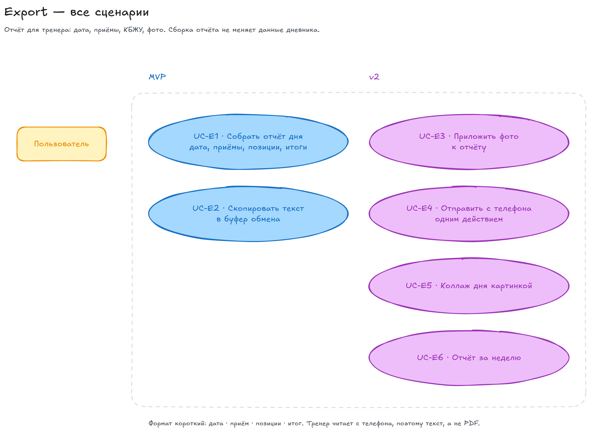
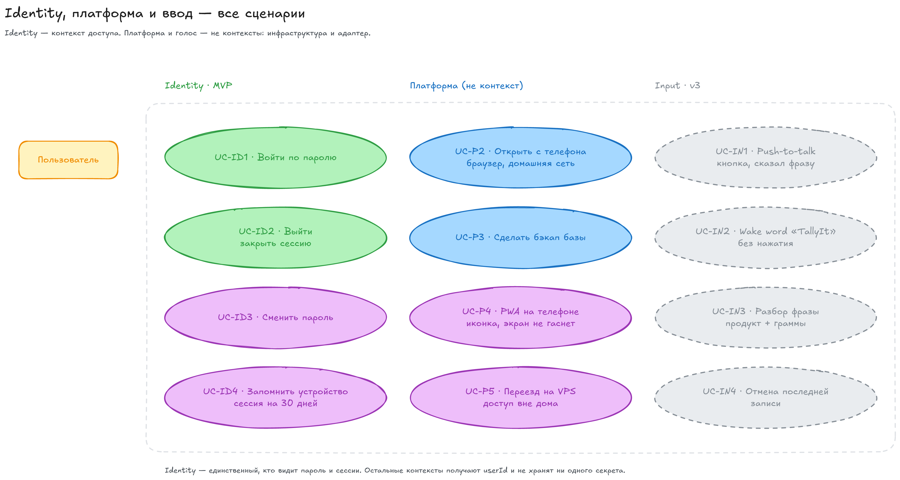
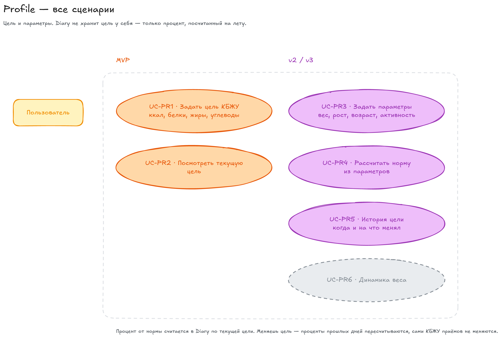

<h1 align="center">TallyIt</h1>

<p align="center">Дневник КБЖУ, который считает готовое блюдо, а не только сырые ингредиенты.</p>

<p align="center">
  <a href="./README.md">Русский</a> | <a href="./docs/en/README.md">English</a>
</p>

## Что это

TallyIt — личное веб-приложение для учёта калорий и БЖУ. Обычные дневники питания считают рецепт по сырым ингредиентам, но во время готовки масса меняется: вода выкипает, жир вытапливается. Приходится вручную считать пропорцию в калькуляторе и пересчитывать порцию на съеденное.

TallyIt пересчитывает сам: ингредиенты вносятся сырыми, затем фиксируется вес готового блюда, и КБЖУ считается на 100 г готового продукта. Съеденное записывается граммами, попадает в приёмы пищи с фото и собирается в короткий отчёт для тренера.

## Статус

Проект в начале: есть требования, диаграммы и инфраструктура. Прикладного кода ещё нет — `backend/` и `frontend/` пусты. Лицензия не выбрана.

## Ключевые решения

| Решение | Зачем |
| --- | --- |
| Пересчёт на вес готового блюда | Не нужно держать в голове пропорцию и считать её в стороннем калькуляторе |
| Снимки КБЖУ на границах | Правка продукта или удаление блюда не переписывает историю приёмов пищи |
| Шесть контекстов вместо одного монолита | Границы держит компилятор: модуль виден снаружи только через свой `*.Contracts` |
| Данные КБЖУ с источником и датой | Видно, откуда взялись числа и когда их стоит перепроверить |
| Отчёт тренеру текстом | Читается с телефона, без PDF и вложенных файлов |

## Архитектура



Синий — MVP, зелёный — Identity, оранжевый — Profile, фиолетовый — v2, серый пунктир — v3.

## Быстрый старт

Нужны Docker с Compose, .NET SDK 10 и Node.js 20 или новее.

```bash
docker compose -f docker/compose.yml up -d
```

Ожидаемый результат: три контейнера со статусом healthy — `postgres` на `127.0.0.1:5432`, `redis` на `127.0.0.1:6379`, `elasticsearch` на `127.0.0.1:9200`. Данные и тома лежат в `./data`.

Сейчас поднимаются только зависимости. Запуск приложений появится вместе с первым кодом Api и Web.

## Сценарии

### Каталог продуктов



### Блюда и пересчёт



### Приёмы пищи



### Отчёт тренеру



### Доступ, платформа и ввод



### Цель КБЖУ



## Структура репозитория

```text
TallyIt/
├── AGENTS.md              требования и правила проекта
├── backend/               .NET: Api, модули, воркеры, тесты
├── frontend/              Next.js
├── docker/compose.yml     Postgres, Redis, Elasticsearch
└── docs/
    ├── ru/diagrams/       диаграммы на русском: PNG и .excalidraw
    └── en/                английский README и английские диаграммы
```

## Документация

| Тема | Что внутри | Ссылка |
| --- | --- | --- |
| Правила проекта | стек, границы контекстов, тесты, запреты, Definition of Done | [AGENTS.md](./AGENTS.md) |
| Диаграммы (редактируемые) | `.excalidraw` рядом с каждым PNG | [docs/ru/diagrams](./docs/ru/diagrams) |
| Английская версия | тот же README и те же диаграммы на английском | [docs/en/README.md](./docs/en/README.md) |

## Границы

- Один пользователь, без ролей и команд.
- Ввод только в граммах: пачки, штуки и доли блюда не поддерживаются.
- Нет остатков блюда, веса тары и сроков годности.
- Голосовой ввод — v3, MVP работает на ручном вводе.
