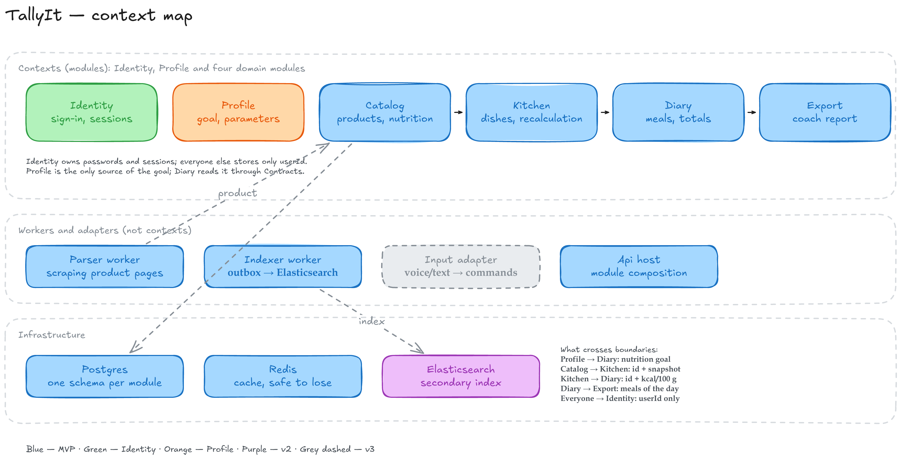
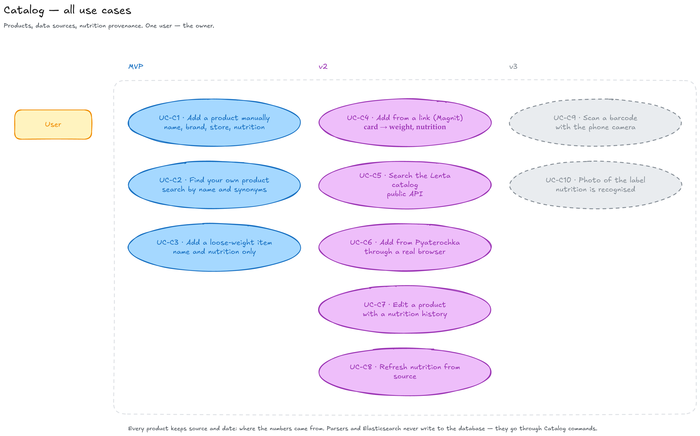
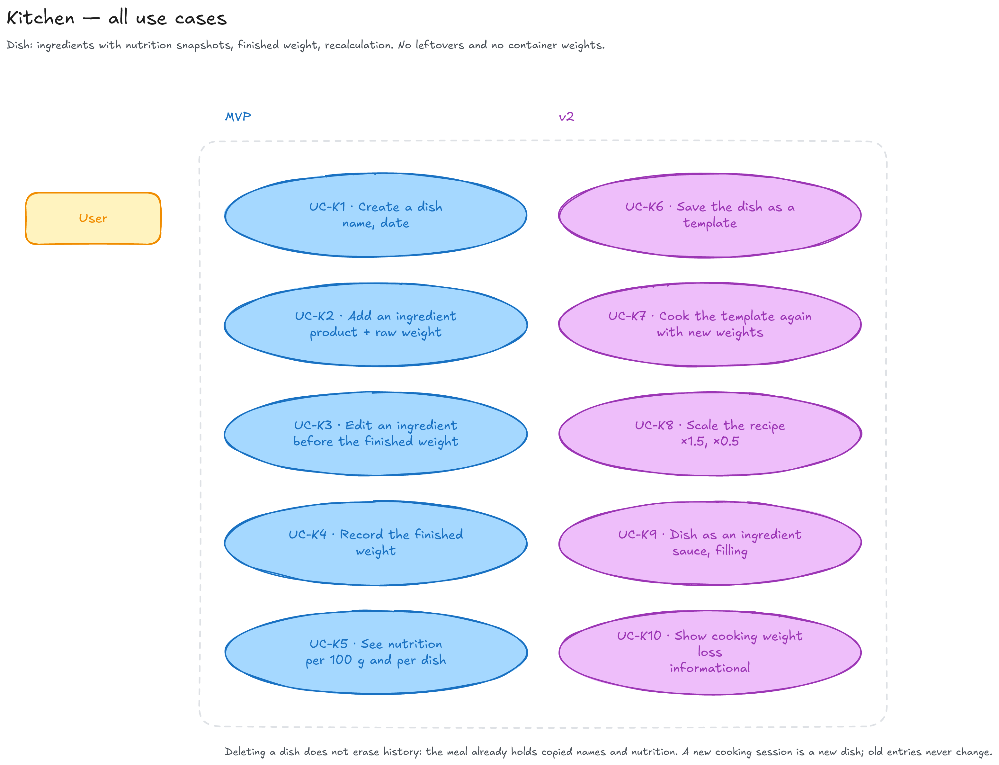
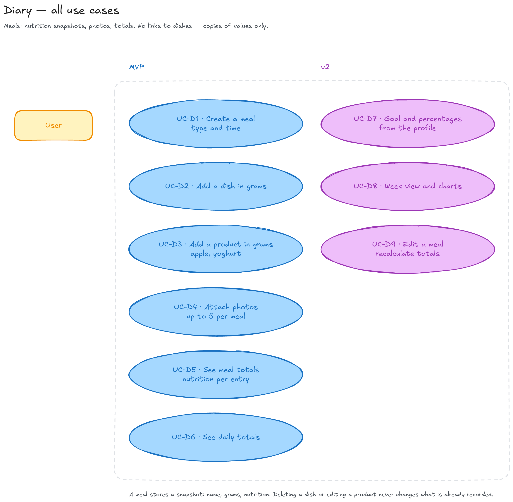
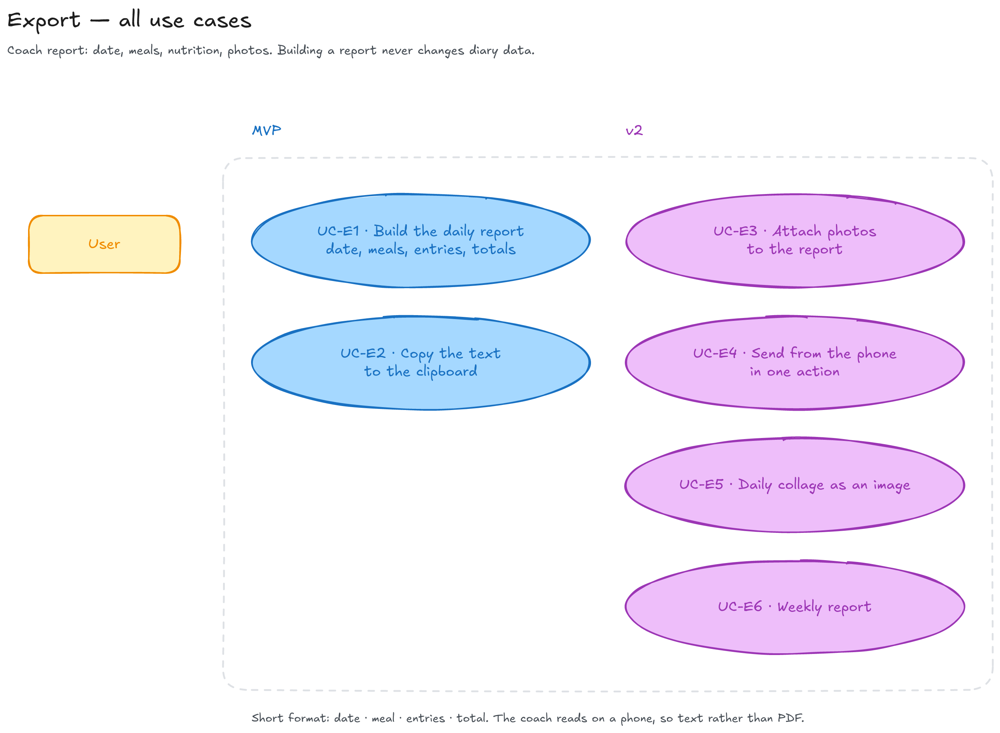
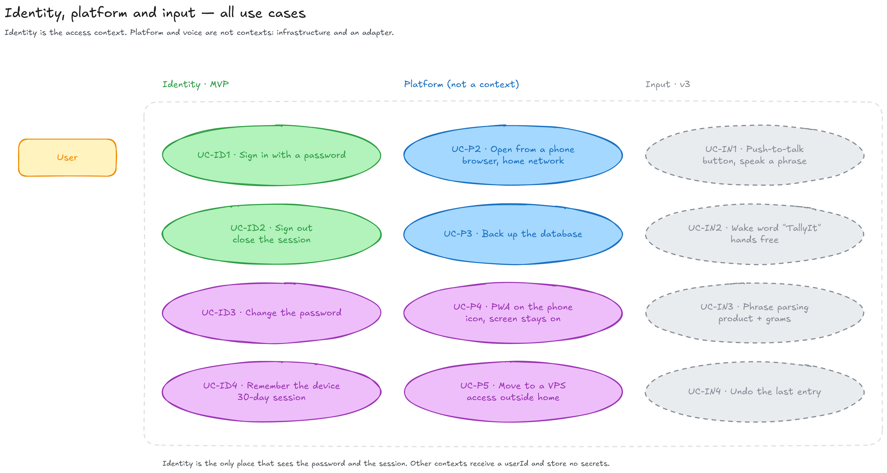
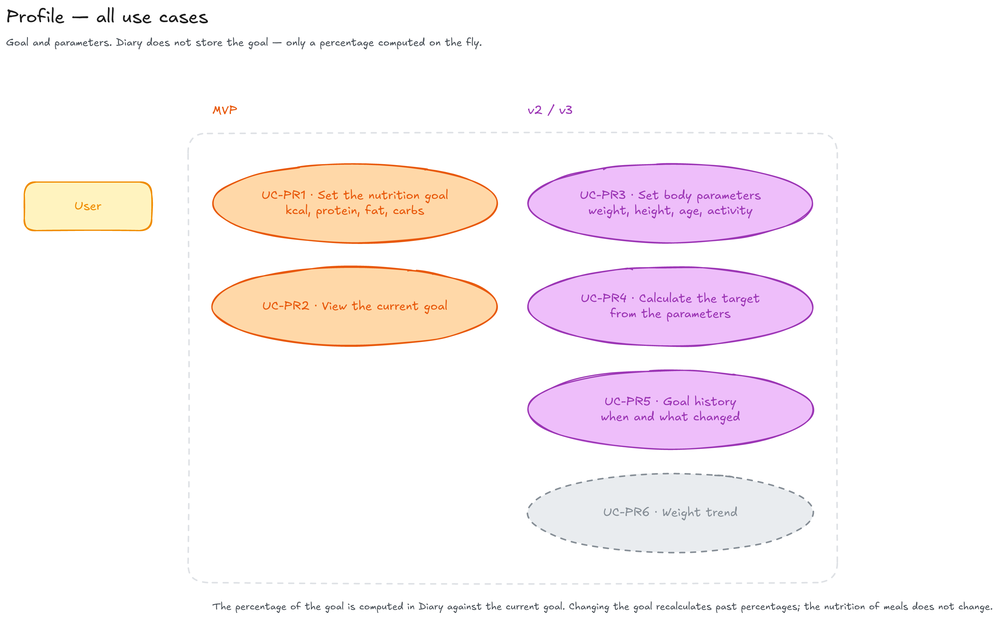

<h1 align="center">TallyIt</h1>

<p align="center">A nutrition tracker that counts the finished dish, not just the raw ingredients.</p>

<p align="center">
  <a href="../../README.md">Русский</a> | <a href="./README.md">English</a>
</p>

## What it is

TallyIt is a personal web app for tracking calories and macronutrients. Usual nutrition diaries compute a recipe from raw ingredients, but cooking changes the mass: water evaporates, fat renders out. The user is left recalculating the proportion in a calculator and converting every portion by hand.

TallyIt does the recalculation: ingredients are entered raw, then the finished dish is weighed, and nutrition is computed per 100 g of the cooked food. What you eat is logged in grams, recorded in meals with photos, and turned into a short report for a coach.

## Status

Early stage: requirements, diagrams and infrastructure exist. There is no application code yet — `backend/` and `frontend/` are empty. No license has been chosen.

## Key decisions

| Decision | Why |
| --- | --- |
| Recalculation against the finished weight | No mental arithmetic and no side calculator while cooking |
| Nutrition snapshots at every boundary | Editing a product or deleting a dish never rewrites meal history |
| Six contexts instead of one monolith | The compiler enforces boundaries: a module is visible only through its own `*.Contracts` |
| Nutrition values keep their source and date | You can see where the numbers came from and when to recheck them |
| Coach report as plain text | Readable on a phone, no PDFs or attachments |

## Architecture



Blue — MVP, green — Identity, orange — Profile, purple — v2, grey dashed — v3.

## Quick start

Requires Docker with Compose, .NET SDK 10 and Node.js 20 or newer.

```bash
docker compose -f docker/compose.yml up -d
```

Expected result: three containers reporting healthy — `postgres` on `127.0.0.1:5432`, `redis` on `127.0.0.1:6379`, `elasticsearch` on `127.0.0.1:9200`. Data and volumes live in `./data`.

Only dependencies start today. Running the Api and the web app arrives together with the first code.

## Use cases

### Product catalog



### Dishes and recalculation



### Meals



### Coach report



### Access, platform and input



### Nutrition goal



## Repository layout

```text
TallyIt/
├── AGENTS.md              project requirements and rules (Russian)
├── backend/               .NET: Api, modules, workers, tests
├── frontend/              Next.js
├── docker/compose.yml     Postgres, Redis, Elasticsearch
└── docs/
    ├── ru/diagrams/       Russian diagrams: PNG and .excalidraw
    └── en/                this README and English diagrams
```

## Documentation

| Topic | What it covers | Link |
| --- | --- | --- |
| Project rules | stack, context boundaries, tests, prohibitions, definition of done | [AGENTS.md](../../AGENTS.md) |
| Diagrams (editable) | `.excalidraw` next to every PNG | [docs/en/diagrams](./diagrams) |
| Russian version | the same README and diagrams in Russian | [README.md](../../README.md) |
